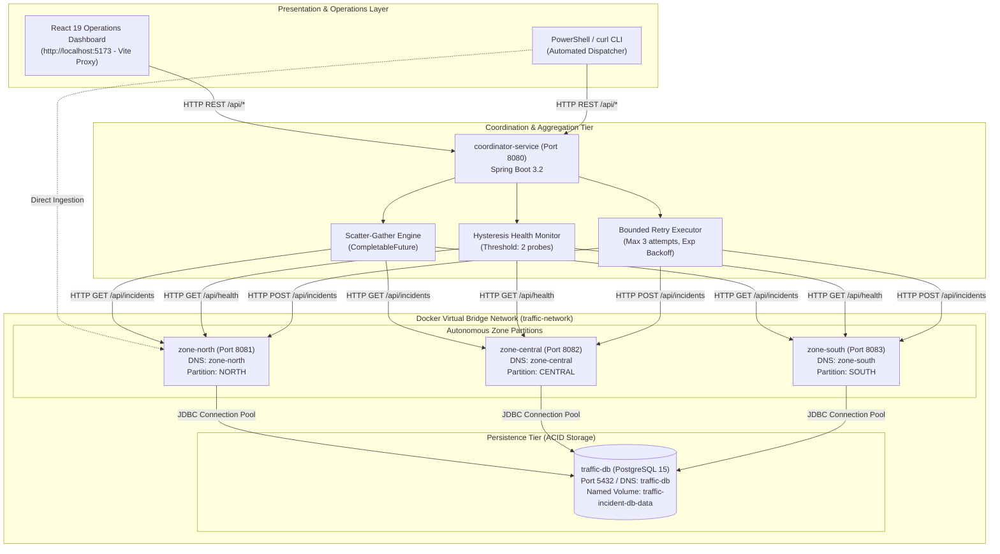

# Distributed Traffic Incident Monitoring System

A resilient, partitioned distributed backend and real-time visualization platform built with **Java 17**, **Spring Boot 3.2**, **Spring Data JPA**, **PostgreSQL 15**, **Spring RestClient**, **Docker Compose**, and **React 19 (Vite)**.

The system partitions a metropolitan area into independent autonomous zones (**North**, **Central**, **South**) that store traffic telemetry durably in **PostgreSQL**. A central **Coordinator Service** queries and aggregates city-wide telemetry over HTTP with background **periodic health checks**, **hysteresis failure/recovery thresholds**, **bounded retries with exponential backoff**, **duplicate submission detection**, and **durable recovery across node crashes**.

---

## 1. Project Documentation Index

Comprehensive engineering documents are organized under [`docs/`](file:///d:/cloud_package/docs):
- [`docs/architecture.md`](file:///d:/cloud_package/docs/architecture.md) — Detailed coordinator, partition nodes, Docker network, and Mermaid sequence diagrams.
- [`docs/system-design.md`](file:///d:/cloud_package/docs/system-design.md) — System workflows, distributed principles, design decisions, and limitations.
- [`docs/test-cases.md`](file:///d:/cloud_package/docs/test-cases.md) — Test specifications (17 automated tests + 5 live E2E scenarios + manual testing checklist).
- [`docs/viva-preparation.md`](file:///d:/cloud_package/docs/viva-preparation.md) — Comprehensive viva voce defense questions and concise answers.

---

## 2. Prerequisites & Environment Requirements

Before running the system, verify your machine meets the following prerequisites:

| Component | Minimum Version | Verification Command | Notes |
|---|---|---|---|
| **Operating System** | Windows 10/11 (64-bit) | `[System.Environment]::OSVersion.Version` | PowerShell 5.1+ or PowerShell 7+ |
| **Java Development Kit** | JDK 17+ | `java -version` | OpenJDK 17 or Oracle JDK 17 |
| **Apache Maven** | Maven 3.8+ | `.\mvnw.cmd -v` | Wrapper included (`mvnw.cmd` / `./mvnw`) |
| **Docker & Docker Compose** | Docker 24+, Compose v2+ | `docker --version; docker compose version` | Docker Desktop with WSL2 backend |
| **Node.js & npm** | Node.js 18+, npm 9+ | `node -v; npm -v` | Required for React Dashboard |

---

## 3. Distributed System Architecture



---

## 4. End-to-End Incident Submission (Sequence Diagram)


---

## 5. Distributed Systems Concepts in This System

### 1. Client-Server Architecture
- The system decouples presentation (React Dashboard / PowerShell CLI) from computational storage. The client requests services over HTTP, while the backend coordinator acts as an aggregation server and client to downstream nodes.

### 2. Service-Based (Partitioned) Architecture
- The city grid is divided into 3 autonomous services (`zone-north`, `zone-central`, `zone-south`). Each runs in its own process/container with independent memory and thread pools. A fatal crash in one district does not bring down the other districts.

### 3. Message Passing over Network
- Services coordinate strictly via message passing (HTTP REST over TCP/IP on the Docker virtual network `traffic-network`) using Spring's modern `RestClient`. There is no shared JVM heap memory.

### 4. Partial Failure & Graceful Degradation
- If a zone node fails or times out, the coordinator catches the error, marks the partition in `unavailableZones`, switches `systemStatus` to `PARTIALLY_DEGRADED`, and returns the surviving data (`200 OK`) without throwing an unhandled `500 Server Error`.

### 5. Fault Tolerance & Hysteresis
- **Hysteresis State Machine**: Prevents flapping due to transient GC pauses or packet drops. Requires **2 consecutive failed probes** before marking a node `OFFLINE`, and **2 consecutive successful probes** before declaring recovery to `ONLINE`.
- **Bounded Retries with Backoff**: The `BoundedRetryExecutor` retries write dispatches up to 3 times with exponential backoff (200ms &rarr; 400ms &rarr; 800ms). Infinite retry loops are strictly prohibited to protect coordinator worker threads.

### 6. Consistency & Idempotent Writes
- **ACID Local Consistency**: Each zone node persists records to PostgreSQL with foreign keys and primary key constraints.
- **Cluster Idempotency**: Pre-dispatch ID assignment guarantees that duplicate network transmissions (retries) do not create redundant database rows; duplicate submissions return `200 OK` with the existing entity.
- **Read Eventual Consistency**: Aggregated reports reflect the live state of responding nodes at query time.

### 7. Real-World Limitations & Production Gaps
- **Shared Database (SPOF)**: All zone nodes connect to a single logical PostgreSQL container (`traffic-db`). In production, each zone would own an isolated database (Database-per-Service pattern) or use a distributed database like CockroachDB.
- **No Distributed Transactions (2PC)**: Cross-zone multi-district incidents are not supported; in production, an event-driven Saga pattern via Apache Kafka would manage cross-partition state.

---

## 6. Setup & Execution (Exact Windows PowerShell Commands)

### Step 1: Start the Backend Docker Cluster
Open a PowerShell terminal in the project root:
```powershell
cd d:\cloud_package
docker compose up --build -d
```
Verify all 5 containers are running and healthy:
```powershell
docker compose ps
```
**Expected Output:**
```text
NAME                  IMAGE                               STATUS                   PORTS
coordinator-service   cloud_package-coordinator-service   Up 2 minutes (healthy)   0.0.0.0:8080->8080/tcp
zone-north            cloud_package-zone-north            Up 2 minutes (healthy)   0.0.0.0:8081->8081/tcp
zone-central          cloud_package-zone-central          Up 2 minutes (healthy)   0.0.0.0:8082->8082/tcp
zone-south            cloud_package-zone-south            Up 2 minutes (healthy)   0.0.0.0:8083->8083/tcp
traffic-db            postgres:15-alpine                  Up 2 minutes (healthy)   0.0.0.0:5432->5432/tcp
```

---

### Step 2: Start the React Operations Dashboard
Open a second PowerShell terminal:
```powershell
cd d:\cloud_package\dashboard
npm install
npm run dev
```
Open your browser and navigate to: **`http://localhost:5173/`**

---

### Step 3: Run Backend Automated Tests (17/17 Passed)
```powershell
cd d:\cloud_package
.\mvnw.cmd test
```
**Expected Output:** `Tests run: 17, Failures: 0, Errors: 0, Skipped: 0. BUILD SUCCESS.`

---

## 7. REST API Examples & Verification Commands

### A. Health Check Probes
```powershell
# Zone Nodes
Invoke-RestMethod -Uri "http://localhost:8081/api/health" | ConvertTo-Json
Invoke-RestMethod -Uri "http://localhost:8082/api/health" | ConvertTo-Json
Invoke-RestMethod -Uri "http://localhost:8083/api/health" | ConvertTo-Json

# Coordinator Service
Invoke-RestMethod -Uri "http://localhost:8080/api/coordinator/health" | ConvertTo-Json
```

### B. Query City-Wide Aggregated Report
```powershell
Invoke-RestMethod -Uri "http://localhost:8080/api/coordinator/city-report" | ConvertTo-Json -Depth 5
```

### C. Submit Incident via Coordinator (With Duplicate Detection Test)
```powershell
$incident = @{
    id = "INC-SOUTH-DURABLE-999"
    zoneId = "SOUTH"
    type = "ACCIDENT"
    severity = "HIGH"
    description = "Cargo container toppled over on South Port Access Ramp"
    status = "ACTIVE"
} | ConvertTo-Json

# First submission: 201 Created
$res1 = Invoke-RestMethod -Uri "http://localhost:8080/api/coordinator/incidents" -Method Post -Body $incident -ContentType "application/json"
Write-Host "Created: $($res1.id), Status: $($res1.status)"

# Second submission (duplicate retry simulation): 200 OK (idempotent)
$res2 = Invoke-RestMethod -Uri "http://localhost:8080/api/coordinator/incidents" -Method Post -Body $incident -ContentType "application/json"
Write-Host "Duplicate Detected: $($res2.id), Status: $($res2.status)"
```

### D. Update Incident Lifecycle Status
```powershell
Invoke-RestMethod -Uri "http://localhost:8083/api/incidents/INC-SOUTH-DURABLE-999/status?status=RESOLVED" -Method Patch | ConvertTo-Json
```

---

## 8. Fault-Tolerance Demonstration Workflow (Viva Ready)

Demonstrate resilience live during an evaluation:

1. **Stop South District Node**:
   ```powershell
   docker compose stop zone-south
   ```
2. **Observe Degraded Mode**:
   - In Dashboard or via `GET /api/coordinator/city-report`, observe `systemStatus: "PARTIALLY_DEGRADED"`.
   - `unavailableZones` shows `["SOUTH"]`.
   - Incidents from North and Central continue to be displayed without interruption.
3. **Restart South District Node**:
   ```powershell
   docker compose start zone-south
   ```
4. **Observe Durable Recovery**:
   - Check South logs: `docker compose logs --tail=20 zone-south`.
   - Log confirms: `DURABLE RECOVERY: Found 2 existing persisted incidents... Preserving data`.
   - Within 10 seconds (2 health probes), node status restores to `ONLINE`.
   - Dynamic incident `INC-SOUTH-DURABLE-999` remains in the database intact.

---

## 9. Troubleshooting & FAQ

| Issue / Symptom | Root Cause | Solution |
|---|---|---|
| **`connectex: No connection could be made` (Port 8080)** | Host port 8080 is reserved by Windows or another service (e.g. IIS, Oracle, or local Java). | Access coordinator via Vite Dev Server proxy (`http://localhost:5173/api/*`) or map host port in `docker-compose.yml` (`- "8088:8080"`). |
| **`permission denied unix:///var/run/docker.sock` in WSL** | Non-root WSL user lacks Docker socket permissions. | Run with `-u root`: `wsl -d Ubuntu-22.04 -u root docker ps` or add your WSL user to the `docker` group (`sudo usermod -aG docker $USER`). |
| **Zone node exits immediately during `docker compose up`** | Database container not yet ready to accept TCP connections. | Docker Compose healthcheck dependency ensures zone nodes wait until `traffic-db` reports `healthy`. If needed, re-run: `docker compose up -d`. |
| **CORS errors when accessing backend directly** | Cross-origin requests from frontend to backend. | Use the configured Vite reverse proxy (`http://localhost:5173/api/...`), which forwards requests server-side, eliminating browser CORS checks. |

---

## 10. Clean Shutdown Instructions

To gracefully stop and tear down the cluster:

```powershell
# 1. Stop the React Dashboard dev server:
# Press Ctrl + C in the dashboard terminal window.

# 2. Stop and remove Docker containers and networks:
cd d:\cloud_package
docker compose down

# 3. Optional: To delete the durable PostgreSQL volume (clean reset):
docker compose down -v
```
