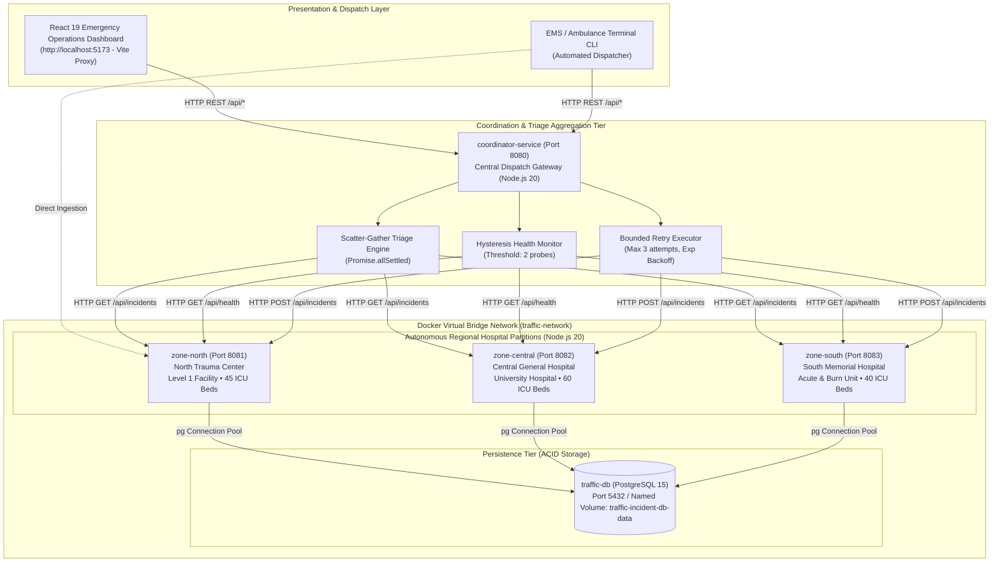
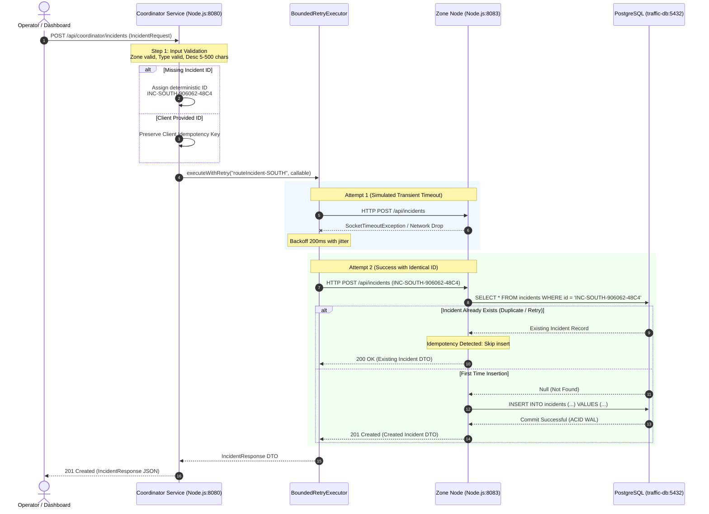

# PulseGrid — Distributed Emergency Medical & Hospital Surge Network

A resilient, partitioned distributed emergency healthcare platform built with **Node.js 20+ (ES Modules)**, **Express.js**, **PostgreSQL 15 (`pg` connection pool)**, **Docker Compose**, and **React 19 (Vite)**.

During major metropolitan emergencies (mass casualty incidents, power grid blackouts, natural disasters), centralized communications often fail. PulseGrid partitions the city into independent autonomous hospital centers (**North Trauma Center**, **Central General Hospital**, **South Memorial Hospital**) that store clinical triage admissions and ICU capacity durably in **PostgreSQL**. A central **Emergency Medical Dispatch Coordinator** queries and aggregates city-wide bed availability over HTTP with background **periodic health checks**, **hysteresis failure/recovery thresholds**, **bounded retries with exponential backoff**, **duplicate patient intake prevention**, and **durable recovery across hospital partition outages**.

---

## 1. Project Documentation Index

Comprehensive engineering documents are organized under [`docs/`](file:///d:/cloud_package/docs):
- [`docs/architecture.md`](file:///d:/cloud_package/docs/architecture.md) — Detailed coordinator, hospital partition nodes, Docker network, and Mermaid sequence diagrams.
- [`docs/system-design.md`](file:///d:/cloud_package/docs/system-design.md) — System workflows, distributed healthcare principles, design decisions, and limitations.
- [`docs/test-cases.md`](file:///d:/cloud_package/docs/test-cases.md) — Test specifications (10 automated unit tests + 5 live E2E scenarios + manual testing checklist).
- [`docs/viva-preparation.md`](file:///d:/cloud_package/docs/viva-preparation.md) — Comprehensive viva voce defense questions and concise answers.

---

## 2. Prerequisites & Environment Requirements

| Component | Minimum Version | Verification Command | Notes |
|---|---|---|---|
| **Operating System** | Windows 10/11 (64-bit) | `[System.Environment]::OSVersion.Version` | PowerShell 5.1+ or PowerShell 7+ |
| **Node.js & npm** | Node.js 20+, npm 9+ | `node -v; npm -v` | Node.js v26.5.0 verified |
| **Docker & Docker Compose** | Docker 24+, Compose v2+ | `docker --version; docker compose version` | Docker Desktop with WSL2 backend |

---

## 3. Distributed System Architecture



---

## 4. End-to-End Incident Submission (Sequence Diagram)



---

## 5. Distributed Systems Concepts in This System

1. **Client-Server Architecture**: Strict decoupling of the React frontend from distributed computational storage over structured HTTP REST interfaces.
2. **Service-Based Partitioning**: The city grid is divided into 3 autonomous services (`zone-north`, `zone-central`, `zone-south`). Each container runs an independent Node.js process with dedicated connection pools.
3. **Message Passing**: Coordination occurs strictly via HTTP REST messages over TCP/IP across the virtual Docker bridge network (`traffic-network`) using native `fetch` with timeouts.
4. **Partial Failure & Graceful Degradation**: The coordinator's `Promise.allSettled()` scatter-gather query catches downstream network errors, reports offline partitions in `unavailableZones`, transitions status to `PARTIALLY_DEGRADED`, and returns surviving partition data without failing the user request.
5. **Fault Tolerance & Hysteresis**:
   - **Hysteresis State Machine**: Prevents flapping due to momentary packet drops. Requires **2 consecutive failed probes** before marking a node `OFFLINE`, and **2 consecutive successful probes** before declaring recovery to `ONLINE`.
   - **Bounded Retries with Backoff**: The `retryExecutor.js` limits write retries to 3 attempts with exponential backoff (200ms &rarr; 400ms &rarr; 800ms). Infinite retry loops are strictly prohibited.
6. **Consistency & Idempotent Writes**:
   - Local ACID transactions and primary key constraints in PostgreSQL prevent duplicate rows.
   - Idempotency key assignment prior to network dispatch ensures retried requests return `200 OK` with the existing entity.

---

## 6. Setup & Execution (Exact Windows PowerShell Commands)

### Step 1: Start the Backend Docker Cluster
Open a PowerShell terminal in the project root:
```powershell
cd d:\cloud_package
docker compose up --build -d
```
Verify all 5 containers are running and healthy:
```powershell
docker compose ps
```
**Expected Output:**
```text
NAME                  IMAGE                               STATUS                   PORTS
coordinator-service   cloud_package-coordinator-service   Up 2 minutes (healthy)   0.0.0.0:8080->8080/tcp
zone-north            cloud_package-zone-north            Up 2 minutes (healthy)   0.0.0.0:8081->8081/tcp
zone-central          cloud_package-zone-central          Up 2 minutes (healthy)   0.0.0.0:8082->8082/tcp
zone-south            cloud_package-zone-south            Up 2 minutes (healthy)   0.0.0.0:8083->8083/tcp
traffic-db            postgres:15-alpine                  Up 2 minutes (healthy)   0.0.0.0:5432->5432/tcp
```

---

### Step 2: Run Automated Backend Tests (10/10 Passed)
```powershell
cd d:\cloud_package\coordinator-service
npm test

cd d:\cloud_package\zone-node
npm test
```
**Expected Output:** All 10 tests pass (6 coordinator, 4 zone node) in < 400ms.

---

### Step 3: Run Live Integration Verification Script
```powershell
cd d:\cloud_package
powershell -ExecutionPolicy Bypass -File test_api.ps1
```
Tests city report aggregation, incident creation, idempotency duplicate detection, and in-place status updates against the live cluster.

---

### Step 4: Run Live Fault-Tolerance & Recovery Simulation
```powershell
cd d:\cloud_package
powershell -ExecutionPolicy Bypass -File test_fault_tolerance.ps1
```
Automatically stops the South zone container, observes partial degradation, restarts the container, and verifies durable recovery.

---

### Step 5: Start the React Operations Dashboard
Open a second PowerShell terminal:
```powershell
cd d:\cloud_package\dashboard
npm install
npm run dev
```
Open your browser and navigate to: **`http://localhost:5173/`**

---

## 7. Clean Shutdown Instructions

To gracefully stop and tear down the cluster:

```powershell
# 1. Stop the React Dashboard dev server:
# Press Ctrl + C in the dashboard terminal window.

# 2. Stop and remove Docker containers and networks:
cd d:\cloud_package
docker compose down

# 3. Optional: To delete the durable PostgreSQL volume (clean reset):
docker compose down -v
```
