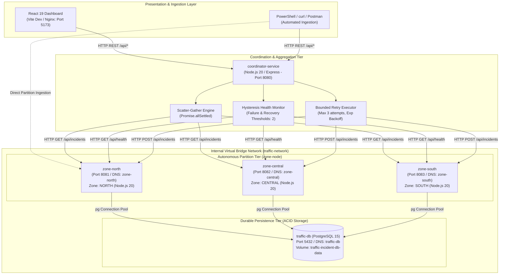
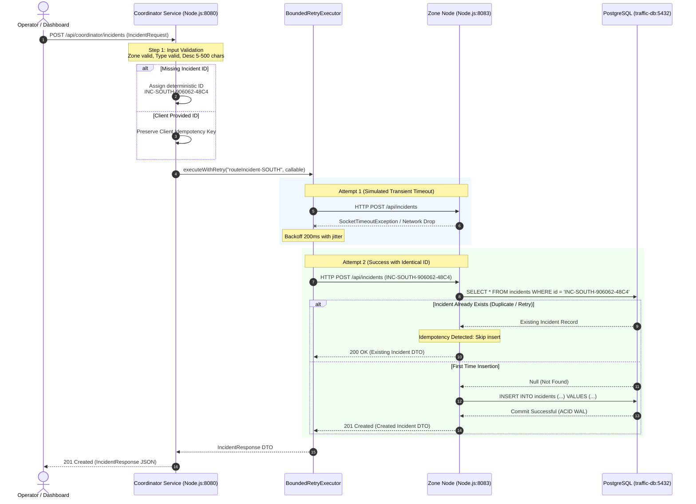

# System Architecture Documentation (Node.js Distributed Edition)

## 1. Executive Summary

The **Distributed Traffic Incident Monitoring System** is a resilient, partitioned distributed backend and real-time visualization platform designed for metropolitan traffic telemetry management. Built using **Node.js 20+ (ES Modules)**, **Express.js**, **PostgreSQL 15 (pg connection pool)**, and **React 19 (Vite)**, the system demonstrates how enterprise distributed systems achieve high availability, graceful degradation, partition tolerance, and crash recovery.

---

## 2. Distributed Architecture Overview

The system decomposes metropolitan traffic management into autonomous partitions, separating data ingestion from central analytical aggregation.

---

## 3. Component Breakdown

### 3.1. Coordinator Service (`coordinator-service`)
- **Technology**: Node.js 20+, Express.js, Native `fetch` with `AbortSignal.timeout()`, ES Modules.
- **Port**: Host port `8080` (Internal container port `8080`).
- **Core Modules**:
  1. **Scatter-Gather Aggregator (`src/aggregator.js`)**: Concurrently fans out queries to all configured zone nodes using JavaScript `Promise.allSettled()` and native `fetch` with socket timeouts. If any node fails or times out, it captures the error and returns partial results without terminating the request.
  2. **Hysteresis Health Monitor (`src/healthMonitor.js`)**: Runs background heartbeat probes (`setInterval`) every 5 seconds. To prevent rapid flapping caused by transient network glitches, it requires **2 consecutive failed probes** before marking a node `OFFLINE`, and **2 consecutive successful probes** before declaring recovery to `ONLINE`.
  3. **Bounded Retry Executor (`src/retryExecutor.js`)**: Applies bounded exponential backoff retries (default 3 attempts, 200ms initial backoff, 2.0x multiplier, capped at 1000ms) for write dispatches. Retries are strictly bounded to prevent thread/event loop starvation and cascading failures.
  4. **Idempotency ID Assigner**: Ensures every incident submitted through the coordinator has a deterministic incident ID (`INC-<ZONE>-<sequence>-<hash>`) assigned *prior* to network dispatch. If a transient network glitch triggers a retry, the identical ID is transmitted, preventing duplicate database entries.

### 3.2. Zone Node Service (`zone-node`)
- **Technology**: Node.js 20+, Express.js, `pg` (PostgreSQL Client Pool), ES Modules.
- **Instances**:
  - `zone-north`: Configured with `ZONE_ID=NORTH`, `ZONE_NAME="North District"`, Port `8081`.
  - `zone-central`: Configured with `ZONE_ID=CENTRAL`, `ZONE_NAME="Central District"`, Port `8082`.
  - `zone-south`: Configured with `ZONE_ID=SOUTH`, `ZONE_NAME="South District"`, Port `8083`.
- **Core Modules**:
  1. **Express Router & Controller (`src/index.js`)**: Exposes REST endpoints for incident creation, querying, filtering, and status updates with field validation.
  2. **Idempotent Incident Service (`src/incidentService.js`)**: Implements `findIncidentById` checks before insertion. If an incident ID already exists, it detects the duplicate, logs the idempotency hit, and returns the existing incident with `200 OK` rather than throwing a duplicate key constraint violation.
  3. **Health Telemetry Controller**: Exposes node metadata, process uptime, active incident count, and operational readiness for Docker health checks and coordinator heartbeats.
  4. **PostgreSQL Client Pool (`src/db.js`)**: Manages connection pooling with automatic connection retry on startup, schema creation, and filtered partition queries.

### 3.3. Durable Storage Service (`traffic-db`)
- **Role**: Shared relational database ensuring ACID durability and persistent crash recovery.
- **Technology**: PostgreSQL 15 Alpine running in Docker container `traffic-db` on port `5432`.
- **Storage**: Docker named volume `traffic-incident-db-data` mounted at `/var/lib/postgresql/data`.
- **Integrity**: Enforces relational schema constraints, primary keys on `id` and `zone_id`, foreign keys, and indexes.

### 3.4. Real-Time Operations Dashboard (`dashboard`)
- **Role**: Single-Page Application (SPA) for systems monitoring, live telemetry, and demonstration.
- **Technology**: React 19, Vite 8, Vanilla CSS, Lucide React icons.
- **Port**: Host port `5173`.
- **Reverse Proxy**: Proxies `/api/*` to the coordinator backend, avoiding browser CORS cross-origin blocks while providing configurable polling (3s, 5s, 10s, 30s) and detailed HTTP wire telemetry.

---

## 4. End-to-End Incident Submission (Sequence Diagram)

