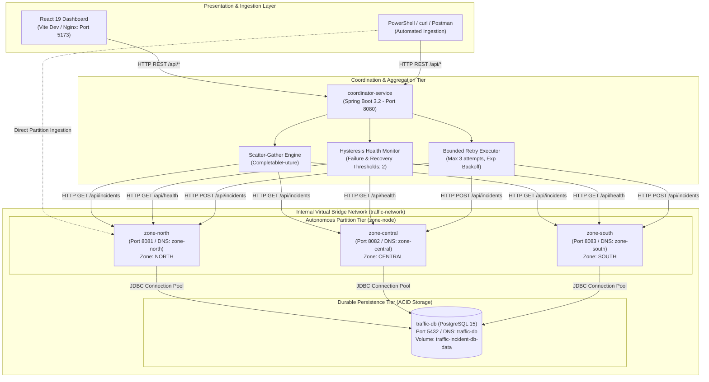
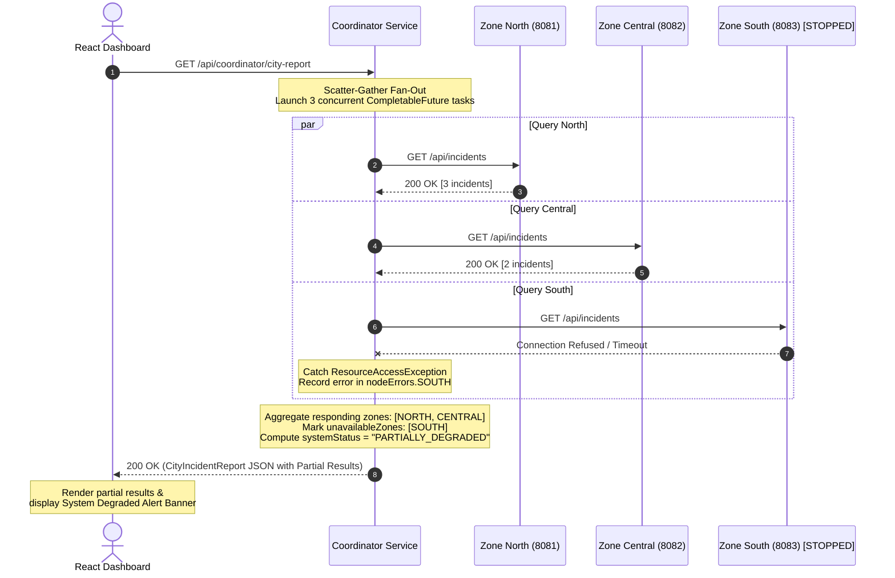

# System Architecture Documentation

## 1. Executive Summary

The **Distributed Traffic Incident Monitoring System** is a resilient, partitioned distributed backend and real-time visualization platform designed for metropolitan traffic telemetry management. Built using **Java 17**, **Spring Boot 3.2**, **Spring Data JPA**, **PostgreSQL 15**, and **React (Vite)**, the system demonstrates how enterprise distributed systems achieve high availability, graceful degradation, partition tolerance, and crash recovery.

---

## 2. Distributed Architecture Overview

The system decomposes metropolitan traffic management into autonomous partitions, separating data ingestion from central analytical aggregation.

---

## 3. Component Breakdown

### 3.1. Coordinator Service (`coordinator-service`)
- **Role**: Stateless aggregator, dispatcher, and health guardian.
- **Port**: Host port `8080` (Internal container port `8080`).
- **Core Modules**:
  1. **Scatter-Gather Aggregator (`AggregationService.java`)**: Concurrently fans out queries to all configured zone nodes using Java `CompletableFuture` and Spring 3.2's modern `RestClient`. If any node fails or times out, it captures the error and returns partial results without terminating the request.
  2. **Hysteresis Health Monitor (`NodeHealthMonitorService.java`)**: Runs background heartbeat probes (`@Scheduled`) every 5 seconds. To prevent rapid flapping caused by transient network glitches, it requires **2 consecutive failed probes** before marking a node `OFFLINE`, and **2 consecutive successful probes** before declaring recovery to `ONLINE`.
  3. **Bounded Retry Executor (`BoundedRetryExecutor.java`)**: Applies bounded exponential backoff retries (default 3 attempts, 200ms initial backoff, 2.0x multiplier, capped at 1000ms) for write dispatches. Retries are strictly bounded to prevent thread starvation and cascading failures.
  4. **Idempotency ID Assigner**: Ensures every incident submitted through the coordinator has a deterministic incident ID (`INC-<ZONE>-<sequence>-<hash>`) assigned *prior* to network dispatch. If a transient network glitch triggers a retry, the identical ID is transmitted, preventing duplicate database entries.

### 3.2. Zone Node Service (`zone-node`)
- **Role**: Autonomous partition server managing traffic incidents for a designated geographic territory.
- **Instances**:
  - `zone-north`: Configured with `ZONE_ID=NORTH`, `ZONE_NAME="North District"`, Port `8081`.
  - `zone-central`: Configured with `ZONE_ID=CENTRAL`, `ZONE_NAME="Central District"`, Port `8082`.
  - `zone-south`: Configured with `ZONE_ID=SOUTH`, `ZONE_NAME="South District"`, Port `8083`.
- **Core Modules**:
  1. **Zone Incident Controller (`ZoneIncidentController.java`)**: Exposes REST endpoints for incident creation, querying, filtering, and status updates.
  2. **Idempotent Incident Service (`ZoneIncidentService.java`)**: Implements `findById` checks before insertion. If an incident ID already exists, it detects the duplicate, logs the idempotency hit, and returns the existing incident with `200 OK` rather than throwing a duplicate key constraint violation.
  3. **Health Telemetry Controller (`ZoneHealthController.java`)**: Exposes node metadata, JVM uptime, active incident count, and operational readiness for Docker health checks and coordinator heartbeats.
  4. **Spring Data JPA & Hibernate Repository (`IncidentRepository.java`)**: Maps entities to PostgreSQL tables and performs filtered partition queries.

### 3.3. Durable Storage Service (`traffic-db`)
- **Role**: Shared relational database ensuring ACID durability and persistent crash recovery.
- **Technology**: PostgreSQL 15 Alpine running in Docker container `traffic-db` on port `5432`.
- **Storage**: Docker named volume `traffic-incident-db-data` mounted at `/var/lib/postgresql/data`.
- **Integrity**: Enforces relational schema constraints, primary keys on `id` and `zone_id`, foreign keys, and indexes.

### 3.4. Real-Time Operations Dashboard (`dashboard`)
- **Role**: Single-Page Application (SPA) for systems monitoring, live telemetry, and demonstration.
- **Technology**: React 19, Vite 8, Vanilla CSS, Lucide React icons.
- **Port**: Host port `5173`.
- **Reverse Proxy**: Proxies `/api/*` to the coordinator backend, avoiding browser CORS cross-origin blocks while providing configurable polling (3s, 5s, 10s, 30s) and detailed HTTP wire telemetry.

---

## 4. Inter-Service Communication & Networking

### 4.1. Docker Virtual Bridge Network (`traffic-network`)
All backend containers communicate across a dedicated, user-defined Docker bridge network:
- **DNS Resolution**: Containers resolve peers via service names (`zone-north`, `zone-central`, `zone-south`, `coordinator-service`, `traffic-db`).
- **Isolation**: Containers are isolated from unauthorized external traffic while exposing specific host ports for local administrative interaction.

### 4.2. Port Allocation Matrix

| Service | Internal Port | Host Port Binding | Protocol | Description |
|---|---|---|---|---|
| `coordinator-service` | `8080` | `0.0.0.0:8080` | HTTP / REST | Public aggregation & dispatch API |
| `zone-north` | `8081` | `0.0.0.0:8081` | HTTP / REST | North District partition API |
| `zone-central` | `8082` | `0.0.0.0:8082` | HTTP / REST | Central District partition API |
| `zone-south` | `8083` | `0.0.0.0:8083` | HTTP / REST | South District partition API |
| `traffic-db` | `5432` | `0.0.0.0:5432` | TCP / PostgreSQL | Relational database engine |
| `dashboard` | `5173` | `0.0.0.0:5173` | HTTP / Web | Operations UI dev server |

---

## 5. End-to-End Incident Submission Sequence Diagram

The following sequence diagram details the end-to-end lifecycle of an incident submission, highlighting idempotency key assignment, bounded retries on transient network errors, database persistence, and client acknowledgment:

---

## 6. City-Wide Aggregated Query Sequence Diagram (Partial Failure)

When an operator or dashboard requests a city-wide report while one zone is experiencing an outage, the coordinator returns partial results with graceful degradation:

