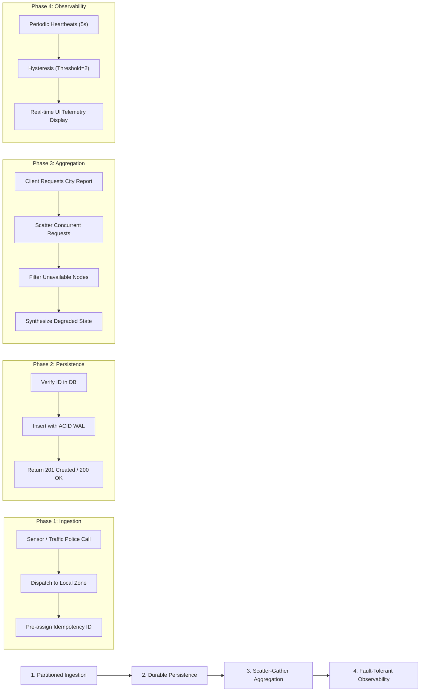

# System Design & Distributed Principles Documentation

## 1. System Design Workflow & Lifecycle

The **Distributed Traffic Incident Monitoring System** models real-world smart-city traffic dispatch platforms. The overall workflow operates across four distinct phases:

---

## 2. Core Distributed Systems Concepts in Practice

### 2.1. Client-Server Architecture
- **Concept**: A distributed computing model where workload is partitioned between service providers (*servers*) and service requesters (*clients*).
- **In This System**:
  - The **React Dashboard** and **PowerShell/CLI scripts** act as HTTP clients requesting data from the backend servers.
  - The **`coordinator-service`** acts as a dual-role entity: it is a *server* to the frontend dashboard, and simultaneously an *HTTP client* to the downstream zone nodes.
  - **Decoupling**: The dashboard is completely stateless; if the browser refreshes, the backend continues processing without interruption.

### 2.2. Service-Based (Microservice-Style) Architecture
- **Concept**: Decomposing an application into independent, loosely coupled services, each dedicated to a discrete business capability and capable of independent lifecycle management.
- **In This System**:
  - The metropolitan area is partitioned into 3 independent zone services (`zone-north`, `zone-central`, `zone-south`), each maintaining its own partition logic.
  - If the `zone-south` container experiences an unhandled memory leak or is terminated for scheduled maintenance, `zone-north` and `zone-central` continue serving traffic incidents without interruption.
  - The `coordinator-service` is an independent aggregation service that can be scaled or updated separately from the partition nodes.

### 2.3. Message Passing (HTTP/REST over TCP/IP)
- **Concept**: Components in a distributed system do not share physical memory or thread state; they coordinate exclusively by exchanging discrete messages over a network.
- **In This System**:
  - Inter-service communication occurs via structured HTTP/1.1 REST calls carrying JSON payloads over the virtual Docker bridge network (`traffic-network`).
  - Spring's `RestClient` manages connection pooling, socket timeouts, and JSON serialization/deserialization.
  - Every network message is subject to standard distributed network hazards: latency, packet loss, socket resets, and transient connection drops.

### 2.4. Partial Failure
- **Concept**: In a monolithic application, when a component crashes, the entire process terminates. In a distributed system, a subset of components can fail while the rest continue operating.
- **In This System**:
  - When one zone node (e.g., `zone-south`) crashes, the coordinator service does **not** fail with an unhandled exception (`500 Internal Server Error`).
  - Instead, the coordinator's `AggregationService` catches `ResourceAccessException` and `HttpClientErrorException`, marks the missing zone in `unavailableZones`, computes `systemStatus = PARTIALLY_DEGRADED`, and returns all incidents from the healthy zones (`200 OK`).
  - The React Dashboard displays an alert banner showing degraded status while preserving normal operational visibility into surviving districts.

### 2.5. Fault Tolerance & Resilience Mechanisms
- **Concept**: The ability of a distributed system to continue operating without interruption despite the failure of one or more internal components.
- **Implemented Mechanisms**:
  1. **Fail-Stop Model**: Node failures are treated as fail-stop (crashed nodes stop responding to HTTP probes rather than sending corrupt data).
  2. **Hysteresis (Flapping Prevention)**:
     - A single transient network glitch (e.g., GC pause or dropped packet) does not trigger an immediate status flip to `OFFLINE`.
     - The coordinator requires **2 consecutive failed health probes** before transitioning status from `ONLINE` &rarr; `OFFLINE`.
     - Similarly, recovery requires **2 consecutive successful probes** before restoring `ONLINE` status.
  3. **Bounded Retries with Exponential Backoff**:
     - The `BoundedRetryExecutor` intercepts network write failures.
     - It retries up to a maximum of 3 attempts with exponential delay (200ms &rarr; 400ms &rarr; 800ms capped at 1000ms).
     - **Safety Guarantee**: Retries are strictly bounded. Infinite retries are avoided to prevent worker thread exhaustion and cascading failures.
  4. **Durable Crash Recovery**:
     - Zone node records are stored in PostgreSQL on a Docker named volume (`traffic-incident-db-data`).
     - When a crashed zone node container restarts, it re-connects to PostgreSQL, verifies existing records, and resumes serving without losing dynamic runtime incidents.

### 2.6. Consistency & Idempotency
- **Concept**: Guarantees regarding data correctness across distributed components and handling duplicate operations.
- **In This System**:
  - **Local Consistency**: Each zone node uses PostgreSQL ACID transactions to ensure local consistency and relational referential integrity.
  - **Cluster-Wide Idempotency**:
    - Network retries can cause an incident submission to arrive at a zone node multiple times (at-least-once delivery).
    - To prevent duplicate incidents, the coordinator assigns a deterministic incident ID *before* the first network transmission.
    - The zone node verifies whether the incident ID already exists in the database using `findById`. If found, it skips the insert and returns `200 OK` with the existing record, guaranteeing idempotent writes.
  - **Read Eventual Consistency**: The coordinator's aggregated report reflects the combined state of responding partitions at query time ($t_{\text{query}}$). Temporary partition outages cause reads to reflect partial cluster state until network recovery.

---

## 3. Key Design Decisions & Trade-Offs

| Decision | Chosen Approach | Alternative Considered | Rationale & Trade-Off |
|---|---|---|---|
| **Data Partitioning** | Geographic Partitioning (North, Central, South) | Shared Monolithic Database / Single Node | Geographic partitioning mirrors municipal traffic authority structures and prevents a failure in one district from stopping traffic monitoring in others. |
| **Persistence Engine** | PostgreSQL 15 Container with Named Volume | In-Memory (`ConcurrentHashMap`) / H2 | In-memory storage loses all dynamic incidents on container restart. PostgreSQL provides true ACID durability, enabling tangible crash-recovery demonstrations. |
| **HTTP Client** | Spring Boot 3.2 `RestClient` | Deprecated `RestTemplate` or third-party `Feign` | `RestClient` is modern, non-blocking-ready, fluent, native to Spring 3.x, and provides fine-grained timeout and connection pool controls without third-party dependencies. |
| **Aggregator Concurrency** | `CompletableFuture` Scatter-Gather | Sequential iterative `for` loop | Concurrently querying 3 nodes completes in $\max(T_1, T_2, T_3)$ instead of $\sum(T_1 + T_2 + T_3)$, drastically reducing overall response latency. |
| **Health Check Flapping** | Two-Probe Hysteresis State Machine | Immediate status flipping on 1 probe | Immediate flipping causes routing oscillations during transient network noise. Hysteresis ensures stable status transitions. |
| **Write Retry Strategy** | Bounded Retries (Max 3, Exponential Backoff) | Infinite Retry Loop | Infinite retries exhaust server worker threads during prolonged outages, creating a self-inflicted Denial of Service (DoS). Bounded retries fail gracefully with `503 Service Unavailable`. |
| **Duplicate Prevention** | Deterministic Incident ID + Database Primary Key | Client IP / Timestamp hash | IDs assigned before network dispatch ensure that retried HTTP packets carry identical idempotency tokens. |

---

## 4. Honest System Limitations & Production Gaps

To demonstrate academic rigor and engineering honesty, the following real-world trade-offs in this implementation are explicitly documented:

1. **Shared Database Single Point of Failure (SPOF)**:
   - *Current Implementation*: All three zone nodes connect to a single logical PostgreSQL container (`traffic-db`).
   - *Production Gap*: While the application compute layer is partitioned, the database tier remains centralized. If `traffic-db` crashes, all zone nodes fail.
   - *Production Solution*: Implement the **Database-per-Service** pattern with independent PostgreSQL instances or a distributed database (e.g., CockroachDB, Citus, or Amazon Aurora Multi-Region).

2. **Absence of Distributed Two-Phase Commit (2PC) or Saga Pattern**:
   - *Current Implementation*: Incidents belong exclusively to a single zone.
   - *Production Gap*: If an incident spans border boundaries between North and Central, there is no cross-partition atomic transaction.
   - *Production Solution*: Use an event-driven Saga pattern via Apache Kafka or RabbitMQ with outbox tables.

3. **Client-Side vs Server-Side Idempotency Key Generation**:
   - *Current Implementation*: If the client submits an incident without an `id`, the coordinator assigns one before dispatching.
   - *Production Gap*: If the HTTP request drops between the client and the coordinator *before* reaching the coordinator, a client resubmission without an explicit ID will generate a new incident.
   - *Production Solution*: Require clients to transmit an `Idempotency-Key` HTTP request header for all state-modifying requests.

4. **Hysteresis Recovery Lag**:
   - *Current Implementation*: Requires 2 consecutive successful health probes spaced by 5 seconds.
   - *Trade-Off*: When a crashed node restarts, there is an intentional 5–10 second delay before the coordinator marks the node `ONLINE`. This trade-off prioritizes cluster stability over instantaneous recovery.
